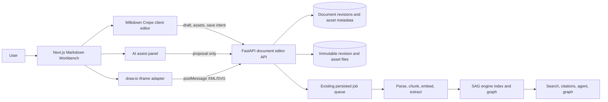
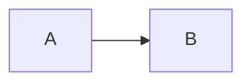

# SAG Markdown Workbench Technical Plan

> Status: proposed design only. This document authorizes no application-code, dependency, deployment, or data migration change.
>
> Decision: use Milkdown Crepe as the in-page editor core. Use HorseMD as an interaction and Markdown-fidelity reference, not as an embedded product or a source fork.

## 1. Purpose And Scope

SAG will gain an online Markdown workbench for viewing, managing, writing, editing, previewing, and maintaining knowledge-base documents. The experience should feel like a Word-style writing surface or Typora live preview: users work on rendered content, use a top command bar and common shortcuts, and do not need Markdown syntax knowledge.

The workbench is part of SAG, not a standalone editor service. Saving a document creates a durable revision and feeds the revised content through the existing SAG ingestion pipeline so search, citations, chunks, entities, and graphs remain traceable to the current content.

### In scope

- Markdown document list, folders/tags, full-text search, creation, WYSIWYG editing, raw-source fallback, preview, revisions, and restore.
- Top command bar and common Word-style keyboard behavior.
- GFM-oriented content: headings, bold, italic, strikethrough, links, lists, task lists, blockquotes, code blocks, tables, images, front matter, math, and Mermaid.
- draw.io embedded visual editing for standard flowcharts, UML, BPMN, network topology, and architecture diagrams.
- AI formatting, polishing, rewriting, checking, and explicit save-to-SAG actions.
- Controlled reuse of the current FastAPI authentication, document/job pipeline, model configuration, source access checks, and Web i18n.

### Out of scope for the first release

- Replacing the existing PDF, Office, web-source, OCTX, or folder-sync ingestion path.
- Directly editing a PDF, DOCX, PPTX, or a parser-generated Markdown view as though it were its original binary file.
- Multi-user real-time collaborative editing. The initial design prevents conflicting saves; operational-transform or CRDT collaboration is a later extension.
- A generic Office clone. Features without a portable Markdown representation, such as arbitrary font family, font size, font color, page layout, and track changes, are not silently stored as proprietary data.

## 2. Product Contract

### 2.1 Editing model

The central writing canvas is WYSIWYG, not a split raw-Markdown/preview interface. Source mode is an expert fallback only. Typing Markdown shorthand may be supported as an accelerator, but no operation requires knowing it.

The page has four persistent regions:

```text
Document library / source navigation
  -> document list, filters, status, new document

Document header
  -> title, save state, revision state, re-index state, AI actions

Top command bar
  -> undo/redo, block style, text format, insert, diagram, view, save

Writing canvas
  -> Milkdown Crepe live-rendered document, optional outline and AI panel
```

The command bar should expose familiar controls: undo/redo, paragraph/heading style, bold, italic, strikethrough, link, quote, ordered/bullet/task list, table, image, code, formula, Mermaid, draw.io diagram, find/replace, source view, and save. Controls use accessible labels and tooltips; keyboard shortcuts take precedence for frequent actions.

### 2.2 Markdown compatibility policy

The canonical persisted format is UTF-8 Markdown plus controlled assets. Base output is CommonMark/GFM-compatible where possible. The initial supported set is deliberately constrained to preserve reliable parse -> edit -> serialize -> reparse behavior.

| Category | First-release policy |
| --- | --- |
| Basic text, headings, links, lists, tables, tasks, quotes, fenced code | Native GFM output |
| Math | `$...$` and `$$...$$` with KaTeX rendering |
| Mermaid | `mermaid` fenced block; rendering is visual, source remains portable |
| Images and diagrams | Markdown relative asset link; managed asset metadata is stored separately |
| Front matter | Preserve YAML front matter as a dedicated document block |
| Underline, font color, arbitrary font size | Not enabled by default; only add later through an explicit HTML-extension policy |
| Raw HTML | Disabled or sanitized by policy; never rendered unsanitized |

This avoids a false promise that every Word operation can round-trip through plain Markdown. If later users require underline or colored text, product must explicitly choose either a constrained HTML extension (`<u>`, allowed `span` styles) or a SAG-only rich-text metadata layer, then document the portability cost.

### 2.3 Editing eligibility

| Document origin | First-release edit behavior |
| --- | --- |
| Markdown uploaded or created in SAG | Direct editable revision |
| Existing plain-text document | Open in source mode or convert explicitly to a managed Markdown document |
| Folder-synced Markdown | Read/edit only after an explicit ownership decision; do not silently write to a read-only `/sync` mount or the user's host folder |
| PDF/Office/web document | Parsed Markdown is readable; "Edit as Markdown" creates a new derived managed document linked to the original |
| OCTX import without original file | Parsed content is readable; derived Markdown can be created, original remains immutable |

## 3. Architecture



### 3.1 Frontend boundaries

The workbench belongs in `apps/web` as a route under the knowledge area, for example `/knowledge/{sourceId}/documents/{documentId}/edit`. It uses the current Next.js App Router, React 19, TypeScript, Tailwind, Radix primitives, `next-intl`, and existing authenticated API client conventions.

Milkdown Crepe is browser-only. The editor wrapper must be a client component and load the editor dynamically after mounting. It owns editor creation and destruction, maps Milkdown updates to local draft state, and never accesses browser APIs from a server component.

Proposed frontend modules:

```text
apps/web/components/features/markdown-workbench/
  markdown-workbench-page.tsx        # page controller and draft lifecycle
  milkdown-editor.tsx                # client-only Crepe wrapper and command bridge
  editor-command-bar.tsx             # SAG toolbar, shortcuts, capability checks
  document-library-pane.tsx          # list/filter/create/open
  document-revision-panel.tsx        # revision history, conflict, restore
  markdown-asset-manager.tsx         # image and diagram references
  mermaid-block-tools.tsx            # block edit/render controls
  drawio-dialog.tsx                  # iframe protocol adapter
  ai-writing-panel.tsx               # proposal, diff, accept/reject UI
  source-mode-dialog.tsx             # controlled expert-mode editing
```

Do not expose Milkdown's internal state throughout the application. `milkdown-editor.tsx` should present a narrow adapter: `getMarkdown`, `setMarkdown`, `focus`, `execute(command)`, `setReadonly`, `onChange`, and `destroy`. This keeps future migration or editor-plugin replacement localized.

### 3.2 Backend boundaries

The current document API can read original files, preview text, return parsed Markdown, upload documents, and enqueue reprocessing. It does not provide editable revision storage or a protected save contract. The new editor API must live next to `apps/api/sag_api/api/v1/documents.py`, with mutation logic in a dedicated document-editor service rather than inside the route handler.

Proposed API surface:

| Endpoint | Purpose |
| --- | --- |
| `GET /sources/{source_id}/documents/{document_id}/editor` | Read editable revision, document metadata, revision number/hash, asset manifest, and indexing state |
| `PUT /sources/{source_id}/documents/{document_id}/editor` | Create an immutable revision using `base_revision` or `If-Match`; returns revision and queued index job |
| `GET /sources/{source_id}/documents/{document_id}/revisions` | Paginated revision list with author, time, reason, index state, and summary |
| `GET /sources/{source_id}/documents/{document_id}/revisions/{revision}` | Read a specific revision for comparison/restoration |
| `POST /sources/{source_id}/documents/{document_id}/revisions/{revision}/restore` | Create a new head revision from an old revision, then queue index processing |
| `POST /sources/{source_id}/documents/{document_id}/assets` | Upload and bind a validated image/diagram asset to the current draft/revision |
| `POST /sources/{source_id}/documents/{document_id}/ai/{action}` | Produce an unsaved AI proposal for an allowed action |

`PUT .../editor` is the only normal save endpoint. It must require authentication, source/document access validation, Markdown and asset validation, optimistic concurrency, audit fields, and a background job. The browser must never write a file path directly.

### 3.3 Revision data model

Keep `Document` as the stable knowledge-library identity. Do not create a new `Document` record for each ordinary edit because citations, UI links, source membership, permissions, and document history would become unstable.

Add a revision layer:

| Entity | Essential fields | Responsibility |
| --- | --- | --- |
| `document_revisions` | id, document_id, sequence, parent_revision_id, storage_path, sha256, size_bytes, title, reason, created_by, created_at | Immutable Markdown content and lineage |
| `document_editor_assets` | id, document_id, revision_id, kind, logical_path, storage_path, sha256, media_type, size_bytes, created_at | Immutable images, draw.io XML, SVG/PNG preview, and asset links |
| `document_index_revisions` | document_id, revision_id, state, job_id, sag_source_id, chunk_count, event_count, error, started_at, completed_at | Links a document revision to its SAG processing result |
| `document_editor_operations` | id, document_id, revision_id, actor, kind, input_hash, output_hash, metadata, created_at | Auditable save, restore, asset, and AI apply events |

Add `head_revision_id` and `indexed_revision_id` to the stable `documents` record. `head_revision_id` is the latest saved writing result. `indexed_revision_id` is the newest successfully indexed revision. This separates writing from search availability and preserves the last known good index if a new revision fails processing.

### 3.4 Save and indexing state machine

```text
local draft
  -> save requested (base revision checked)
  -> revision committed + index job queued
  -> indexing
  -> indexed and promoted
  -> search/citations/graph point to the new revision

If processing fails:
  head revision remains readable
  indexed revision remains the prior successful revision
  UI shows "saved, indexing failed" and offers retry
```

The job payload must identify the immutable revision file, not depend on a mutable document path. Index output should be staged and promoted only after a successful end-to-end parse/chunk/embed/extract run. This prevents a partially processed edit from removing a searchable prior version.

Concurrent saves receive `409 Conflict` when their base revision does not match the current head. First release behavior: show the other revision's summary and offer reload, compare, copy draft, or save as a derived document. Automatic text merging is deferred until collaboration work exists.

### 3.5 File and asset policy

Store revision files and managed assets under an application-controlled directory inside the persistent API data volume. Paths are generated by the service, never accepted from the client. A revision contains portable relative references such as `assets/{asset-id}.svg`; the asset manifest resolves them for the authenticated editor/preview and export packages include the matching files.

Existing generic attachment endpoints may be reused only after their authorization and ownership model is extended. Editor assets require document/revision association, per-source access checks, MIME plus byte-signature validation, maximum size limits, content hashing, and lifecycle cleanup rules.

For folder sync, mounted folders currently may be read-only. The initial workbench never writes back to them. A later optional host write-back agent can implement a separate explicit workflow with path confinement, content hash comparison, external-change detection, user approval, and a conflict policy.

## 4. Diagram Design

### 4.1 Mermaid

Mermaid is a normal Markdown block and remains portable:

````markdown

````

The WYSIWYG view renders it inline and provides a block toolbar for edit, refresh, copy source, and full-screen preview. The first release edits Mermaid source in a focused dialog with templates and validation. It must not claim a fully graphical node-and-edge editor for Mermaid.

### 4.2 draw.io

draw.io handles graphical diagrams that should not require a diagram language: flowcharts, UML, BPMN, network topology, organization charts, and architecture drawings.

Deploy a separate self-hosted diagrams.net/draw.io container behind the same reverse proxy as SAG. It owns no SAG data at rest. SAG owns the original draw.io XML, preview artifact, document association, revision linkage, and authorization. Do not send private diagram XML to the public embed endpoint by default.

The dialog loads a same-origin or explicitly allowlisted iframe. The adapter implements the draw.io embed protocol:

1. Create the iframe with embed mode and a fixed allowed origin.
2. Wait for the protocol `init`/ready event.
3. Send `load` with the revision's draw.io XML.
4. Accept only expected `save`, `autosave`, `export`, and `exit` events from the exact iframe origin and source window.
5. Store autosave as an uncommitted draft asset; an explicit Apply binds XML plus generated SVG/PNG preview to the document draft.
6. Insert/update the Markdown image reference only after Apply; normal document Save creates the immutable document revision.

The backend validates diagram size, XML structure, asset count, and external references. The frontend cannot trust `postMessage` payloads from arbitrary origins. The host page must provide a way to reclaim global shortcuts such as save and command palette while the iframe is focused.

## 5. AI Writing Assistance

AI improves content but never silently publishes it. Every action produces an editable, reviewable proposal; only the normal save command creates a document revision and starts SAG processing.

| Action | Input scope | Output | Required review |
| --- | --- | --- |
| AI layout beautification | Current document or selected blocks | Structure/heading/list/table improvements; no factual invention | Side-by-side or inline diff, accept selected changes |
| Description polishing | Selection | Tone, clarity, grammar, terminology improvements | Diff and source selection retained |
| Rewrite | Selection plus instruction | Replacement text | Diff, accept/reject, optional regenerate |
| Check | Current document | Issues, claims needing evidence, broken links, style inconsistencies | Annotation list; no document mutation by default |
| Knowledge-aware draft | User instruction plus chosen SAG sources | Proposed Markdown with source citations | Source scope shown, citations validated before apply |

Implement a dedicated editor-AI service that reuses SAG's configured model client, access control, diagnostics, cancellation, and streaming patterns. Do not overload the general chat/agent thread storage as the editor's persistence layer. Prompt templates are server-owned, versioned by action, and accept only bounded document/selection context.

For any AI action, record action type, selected source IDs, prompt-template version, input/output hashes, model configuration reference, and user acceptance outcome. Do not store provider API keys, and do not expose hidden system prompts in the client.

## 6. Extension Architecture

The workbench should grow through registries rather than accumulating one-off page conditionals.

| Registry | Examples | Contract |
| --- | --- | --- |
| Editor capability registry | table, math, Mermaid, draw.io, source mode | Declares toolbar command, availability, renderer, serializer, and permission needs |
| Asset provider registry | image, draw.io, later Excalidraw | Declares upload/import/open/preview/export lifecycle |
| AI action registry | polish, rewrite, check, layout | Declares input scope, prompt schema, output schema, review UI, and audit event |
| Document-origin policy | SAG-managed, folder sync, imported binary, OCTX | Declares editable/read-only/derive/write-back behavior |
| Indexer adapter | current SAG processor, future lightweight Markdown-only processor | Accepts immutable revision and returns an index revision result |

This design permits later additions such as Excalidraw, LaTeX diagrams, Git-backed documents, collaboration, AI-generated diagrams, approval workflows, document templates, and source-level policies without coupling them to Milkdown internals.

## 7. Security, Reliability, And Observability

- Authorize every document, revision, asset, diagram, and AI request through the source/document access boundary.
- Enforce optimistic locking for saves; never rely on browser timestamps alone.
- Reject path traversal, unsupported asset types, spoofed MIME types, oversized payloads, unsafe link protocols, and unsanitized HTML.
- Apply strict `postMessage` origin/source checks to draw.io. Use a CSP that permits only the configured self-hosted editor origin in `frame-src`.
- Sanitize rendered Markdown and diagram preview output. Do not execute embedded scripts, remote diagram plugins, or untrusted HTML.
- Preserve last successful index while a new revision is pending or failed. Reprocess uses the saved immutable revision, so retries are deterministic.
- Add audit records for revision create/restore, AI proposal/apply, asset upload/remove, diagram apply, conflict, and index promotion/failure.
- Add diagnostics with document ID, revision ID, source ID, job ID, stage, elapsed time, model action, and error class. Do not log full private document content by default.

## 8. Delivery Phases

### Phase 0: Architecture and UX proof

Build a disposable visual proof using static Markdown only. Validate Chinese input method behavior, long-document typing, toolbar ergonomics, focus/selection behavior, dark mode, desktop and narrow layout, and the final command vocabulary. No persistence or data migration.

### Phase 1: Managed Markdown revisions

Add the revision schema, editor read/save APIs, optimistic concurrency, revision history, restore, and immutable file storage. Support SAG-created and uploaded Markdown documents only. Add save -> queued processing -> index promotion behavior.

### Phase 2: Milkdown workbench

Implement the production route, document library, Crepe wrapper, top command bar, autosaved local draft recovery, source mode, outline, keyboard handling, GFM/math/table/image capabilities, and revision/index status UI.

### Phase 3: Assets and Mermaid

Add managed image assets, portable relative references, Mermaid block tools, validation, safe rendering, export packaging, and document-origin policy presentation.

### Phase 4: Self-hosted draw.io

Add the isolated draw.io deployment, iframe adapter, protocol tests, XML/preview asset persistence, diagram revision behavior, security headers, and failure/recovery UX.

### Phase 5: AI assistance

Add streaming proposal endpoints, diff/accept/reject UI, four core actions (layout, polish, rewrite, check), source-scoped knowledge-aware drafting, audit records, cancellation, and provider failure handling.

### Phase 6: Operational hardening and extensions

Run performance, security, accessibility, backup/restore, indexing-failure, upgrade, and migration tests. Then evaluate optional write-back agent, collaboration, Excalidraw, templates, and approval workflows.

## 9. Acceptance Criteria

### Core writing

- A Chinese-speaking user creates, opens, edits, saves, reopens, and restores a Markdown document without writing Markdown syntax.
- Toolbar actions and `Cmd/Ctrl+B`, `I`, `Z`, `Shift+Z`/`Y`, `S`, `F`, and standard selection behavior work without browser shortcut conflicts.
- A 100,000-character Chinese/English mixed document remains editable without perceptible keystroke loss; performance thresholds are measured before release.
- Parse -> WYSIWYG edit -> save -> reload preserves supported Markdown structures and relative assets.
- Unsupported syntax is clearly preserved in source mode or reported; it is never silently discarded.

### Knowledge-base integrity

- Each save creates a numbered immutable revision with actor/time/hash/reason.
- A save queues processing and the UI distinguishes saved, indexing, indexed, and indexing-failed states.
- Search, citations, outline, entity graph, and agent evidence use the latest successfully indexed revision.
- A failed new revision leaves the previous searchable revision intact and supports a deterministic retry.
- Concurrent saves result in a visible conflict rather than a silent overwrite.

### Diagrams and AI

- Mermaid renders inline, edits safely, and saves as portable Markdown.
- draw.io data never leaves the configured private deployment; XML and preview are revision-bound, protected, and recoverable.
- AI always returns a proposal/diff before mutation; accepted changes remain unsaved until the user saves, or the user explicitly chooses the combined apply-and-save action.
- AI requests respect source scope and record sufficient audit metadata without logging sensitive document bodies.

## 10. Dependencies And Sources

- Milkdown and Crepe: <https://github.com/Milkdown/milkdown>, <https://milkdown.dev/docs/api/crepe>
- HorseMD interaction/reference implementation: <https://github.com/BND-1/horseMD>
- draw.io embed protocol: <https://www.drawio.com/docs/reference/embed-mode/>
- Current SAG document API: `apps/api/sag_api/api/v1/documents.py`
- Current document persistence/job service: `apps/api/sag_api/db/models/document.py`, `apps/api/sag_api/services/document_service.py`
- Current document preview UI: `apps/web/components/features/detail-panel.tsx`
- Current attachment handling: `apps/api/sag_api/api/v1/attachments.py`

## 11. Explicit Decisions Needed Before Coding

1. Are folder-synced documents read-only in the first release, as proposed, or is host write-back a first-release requirement?
2. What maximum editable document size, revision retention period, asset size, and per-source storage quota should apply?
3. Is pure GFM portability mandatory, or may approved HTML extensions represent underline and text color?
4. Is the first deployment single-user/local identity only, or must it enforce multi-user roles before editor release?
5. Does the private deployment already have a reverse proxy/domain strategy for a self-hosted draw.io service, or should Phase 4 include that infrastructure decision?
6. Which SAG model profile is permitted for AI assistance, and what content-retention/provider policy applies to private knowledge documents?
