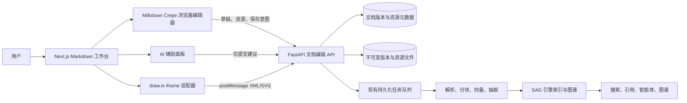

# SAG Markdown 在线编辑工作台技术方案（中文版）

> 状态：仅为拟定技术方案。本文件不授权任何应用代码、依赖、部署配置或数据迁移变更。
>
> 已确定：以 Milkdown Crepe 作为 SAG 页面内嵌编辑器内核；以 HorseMD 的交互体验和 Markdown 保真策略作为参考，不嵌入、不直接复用 HorseMD 产品代码。

## 如何检查这份方案

若你不需要看技术细节，按下面顺序确认即可：

1. 先看“第 1、2 节”，确认目标体验是否就是你想要的 Word/Typora 式在线编辑，而不是传统的左右分栏 Markdown 编辑器。
2. 再看“第 3.3、3.4 节”，确认编辑后能生成历史版本，并且新内容会可靠进入 SAG 的搜索、引用、知识图谱和智能体，而不会覆盖旧的可检索内容。
3. 看“第 4 节”，确认 Mermaid 和私有化 draw.io 的处理方式符合图示编辑和数据不出内网的要求。
4. 看“第 5 节”，确认 AI 只能给出可审阅的建议，不能在用户不确认时直接修改或发布文档。
5. 最后逐项回答“第 11 节”的 6 个待确认问题。该节确认后即可进入开发拆分和排期。

## 1. 目标与范围

SAG 将增加一个在线 Markdown 工作台，用于查看、管理、新建、编辑、预览和维护知识库文档。使用体验应接近 Word 或 Typora 的实时预览：用户面对的是排版后的内容，通过顶部工具栏和常用快捷键完成操作，不需要理解 Markdown 语法。

该工作台属于 SAG，不是一个孤立的在线编辑器。每次保存都会创建可追溯的文档版本，并将该版本送入现有 SAG 处理链路，使搜索、引用、分块、实体和知识图谱都能追溯到当前成功入库的内容。

### 本期范围

- Markdown 文档列表、文件夹和标签、全文检索、新建、所见即所得编辑、源码兜底、预览、版本历史和恢复。
- 顶部操作栏以及接近 Word 的常用键盘行为。
- 面向 GFM 的内容：标题、粗体、斜体、删除线、链接、列表、任务列表、引用、代码块、表格、图片、Front Matter、公式和 Mermaid。
- 基于 draw.io 嵌入模式的流程图、UML、BPMN、网络拓扑图和架构图编辑。
- AI 排版美化、文字润色、改写、检查，以及明确的“保存并进入 SAG 处理”动作。
- 受控复用现有 FastAPI 鉴权、文档与任务处理链路、模型配置、数据源访问校验及 Web 国际化能力。

### 首期明确不做

- 不替换现有 PDF、Office、网页、OCTX 或本地文件夹同步的导入链路。
- 不把 PDF、DOCX、PPTX 或解析得到的 Markdown 当成原始二进制文件直接修改。
- 不做多人实时协同编辑。首期只防止互相覆盖；OT/CRDT 协同留作后续能力。
- 不把它做成通用 Office 克隆。没有可靠 Markdown 表达的任意字体、字号、颜色、页面布局和修订痕迹，不会被悄悄存成私有格式。

## 2. 用户体验约定

### 2.1 编辑方式

主编辑区域是所见即所得画布，不是“左边 Markdown 源码、右边预览”的双栏界面。源码模式只给熟悉 Markdown 的用户做兜底。可以支持用户输入 Markdown 快捷写法作为加速方式，但任何功能均不要求用户会写语法。

页面固定由四个区域构成：

```text
文档库 / 数据源导航
  -> 文档列表、筛选、状态、新建文档

文档页头
  -> 标题、保存状态、版本状态、重新入库状态、AI 操作

顶部操作栏
  -> 撤销/重做、段落样式、文本格式、插入、图示、视图、保存

写作画布
  -> Milkdown Crepe 实时渲染的文档，可选大纲和 AI 面板
```

顶部操作栏应提供：撤销/重做、段落和标题样式、粗体、斜体、删除线、链接、引用、有序/无序/任务列表、表格、图片、代码、公式、Mermaid、draw.io 图、查找替换、源码视图和保存。每个控件都应有中文可访问标签与悬停提示；高频操作优先支持快捷键。

### 2.2 Markdown 兼容与保真规则

最终保存格式为 UTF-8 Markdown 加受控附件。基础输出优先保持 CommonMark/GFM 兼容。首期支持范围应受约束，以保证“解析 -> 编辑 -> 保存 -> 再解析”稳定可靠。

| 内容类别 | 首期保存规则 |
| --- | --- |
| 普通文本、标题、链接、列表、表格、任务、引用、围栏代码 | 原生 GFM |
| 公式 | 使用 `$...$` 与 `$$...$$`，页面用 KaTeX 渲染 |
| Mermaid | 使用 `mermaid` 围栏代码块；页面视觉渲染，源码保持可迁移 |
| 图片和图示 | Markdown 相对资源链接；资源管理信息独立保存 |
| Front Matter | 作为独立文档块保留 YAML Front Matter |
| 下划线、文字颜色、任意字号 | 首期默认不开放；后续只能通过明确的 HTML 扩展策略加入 |
| 原始 HTML | 按策略关闭或净化；不得未经净化直接渲染 |

这项规则避免承诺“所有 Word 功能都能无损转回纯 Markdown”。若以后确实需要下划线或文字颜色，产品必须明确选择：有限的 HTML 扩展（如 `<u>` 或受控 `span` 样式），或 SAG 专属富文本元数据，并接受相应的跨工具兼容成本。

### 2.3 哪些文档允许编辑

| 文档来源 | 首期编辑行为 |
| --- | --- |
| 在 SAG 新建或上传的 Markdown | 可直接创建编辑版本 |
| 已有纯文本文件 | 在源码模式打开，或明确转换为 SAG 管理的 Markdown 文档 |
| 本地文件夹同步的 Markdown | 在归属策略确认前仅可读；不得悄悄写回只读 `/sync` 挂载或用户主机目录 |
| PDF、Office、网页文档 | 解析 Markdown 可阅读；“作为 Markdown 编辑”会创建一个关联原文的新派生文档 |
| 没有原始文件的 OCTX 导入 | 解析内容可阅读；可新建派生 Markdown，原记录保持不可变 |

## 3. 整体技术架构



### 3.1 前端边界

工作台位于 `apps/web` 知识库区域，例如 `/knowledge/{sourceId}/documents/{documentId}/edit`。它继续使用现有 Next.js App Router、React 19、TypeScript、Tailwind、Radix 基础组件、`next-intl` 和已认证 API 客户端约定。

Milkdown Crepe 只能在浏览器运行。编辑器包装层必须是客户端组件，挂载完成后再动态加载编辑器。该层负责创建和销毁编辑器、把 Milkdown 变更映射为本地草稿，不允许在服务端组件中访问浏览器 API。

建议的前端模块：

```text
apps/web/components/features/markdown-workbench/
  markdown-workbench-page.tsx        # 页面控制与草稿生命周期
  milkdown-editor.tsx                # 仅客户端的 Crepe 包装及命令桥接
  editor-command-bar.tsx             # SAG 工具栏、快捷键、能力校验
  document-library-pane.tsx          # 列表、筛选、新建、打开
  document-revision-panel.tsx        # 版本历史、冲突、恢复
  markdown-asset-manager.tsx         # 图片和图示资源引用
  mermaid-block-tools.tsx            # Mermaid 块编辑和渲染控件
  drawio-dialog.tsx                  # iframe 协议适配器
  ai-writing-panel.tsx               # 建议、差异、接受/拒绝界面
  source-mode-dialog.tsx             # 受控的专家源码编辑
```

不要让 Milkdown 的内部状态散落在整个系统。`milkdown-editor.tsx` 只暴露很小的适配接口：`getMarkdown`、`setMarkdown`、`focus`、`execute(command)`、`setReadonly`、`onChange` 和 `destroy`。今后替换编辑器或增加插件时，影响将被限制在这一层。

### 3.2 后端边界

现有文档 API 已能读取原文件、预览文本、返回解析 Markdown、上传文档并入队重新处理，但还没有“可编辑版本存储”和安全保存约定。新的编辑 API 应放在 `apps/api/sag_api/api/v1/documents.py` 相邻位置，具体修改逻辑应在独立的文档编辑服务中，而不是堆在路由处理器里。

建议 API：

| 接口 | 用途 |
| --- | --- |
| `GET /sources/{source_id}/documents/{document_id}/editor` | 获取可编辑版本、文档元数据、版本号/哈希、资源清单和索引状态 |
| `PUT /sources/{source_id}/documents/{document_id}/editor` | 带 `base_revision` 或 `If-Match` 创建不可变版本；返回版本和已入队索引任务 |
| `GET /sources/{source_id}/documents/{document_id}/revisions` | 分页获取版本列表，含操作者、时间、原因、索引状态和摘要 |
| `GET /sources/{source_id}/documents/{document_id}/revisions/{revision}` | 读取指定版本，用于对比或恢复 |
| `POST /sources/{source_id}/documents/{document_id}/revisions/{revision}/restore` | 从旧版本生成一个新的当前版本，并重新入队处理 |
| `POST /sources/{source_id}/documents/{document_id}/assets` | 上传并绑定已校验的图片/图示资源 |
| `POST /sources/{source_id}/documents/{document_id}/ai/{action}` | 为允许的 AI 操作生成尚未保存的建议 |

正常保存只能走 `PUT .../editor`。该接口必须鉴权、校验用户对数据源/文档的权限、校验 Markdown 和资源、执行乐观并发控制、记录审计字段并创建后台任务。浏览器不得直接写入服务端文件路径。

### 3.3 版本数据模型

`Document` 保持为知识库中稳定的文档身份。一次普通编辑不能新建一条 `Document`，否则引用、页面链接、数据源归属、权限和历史都会不稳定。

新增版本层：

| 实体 | 核心字段 | 职责 |
| --- | --- | --- |
| `document_revisions` | id、document_id、sequence、parent_revision_id、storage_path、sha256、size_bytes、title、reason、created_by、created_at | 不可变 Markdown 内容与版本血缘 |
| `document_editor_assets` | id、document_id、revision_id、kind、logical_path、storage_path、sha256、media_type、size_bytes、created_at | 不可变图片、draw.io XML、SVG/PNG 预览和资源关联 |
| `document_index_revisions` | document_id、revision_id、state、job_id、sag_source_id、chunk_count、event_count、error、started_at、completed_at | 连接文档版本与 SAG 处理结果 |
| `document_editor_operations` | id、document_id、revision_id、actor、kind、input_hash、output_hash、metadata、created_at | 可审计的保存、恢复、资源和 AI 应用事件 |

在稳定的 `documents` 表增加 `head_revision_id` 与 `indexed_revision_id`：

- `head_revision_id`：用户最近保存的写作版本。
- `indexed_revision_id`：最新已成功进入 SAG 索引的版本。

两者分离后，即使新版本处理失败，用户仍可阅读新版本，同时搜索仍保留上一份成功索引的内容，不会造成知识库“写完就全搜不到”。

### 3.4 保存与重新入库状态机

```text
本地草稿
  -> 请求保存（先检查基础版本）
  -> 提交新版本 + 创建索引任务
  -> 正在入库
  -> 入库成功并提升为当前索引版本
  -> 搜索、引用、图谱使用新版本

若处理失败：
  新保存版本仍可阅读
  已索引版本仍指向上一份成功版本
  页面显示“已保存，但入库失败”，并提供重试
```

任务负载必须指向不可变的版本文件，不得依赖一个会被下一次保存覆盖的文档路径。索引输出也应先暂存，只有完整通过解析、分块、向量和抽取后才提升为当前结果，防止半成品编辑把旧的可检索内容清掉。

当用户基于旧版本保存时，后端返回 `409 Conflict`，不允许静默覆盖。首期界面应显示对方版本摘要，并让用户选择重新加载、对比、复制当前草稿或另存为派生文档。自动文本合并放到后续协同编辑阶段。

### 3.5 文件与资源规则

版本文件和受管理资源应保存在 API 持久化数据卷中的应用控制目录。路径由服务端生成，客户端不得提交路径。Markdown 中只保存便携的相对引用，例如 `assets/{asset-id}.svg`；资源清单负责为已鉴权的编辑和预览解析真实资源，导出文档包时一并带出匹配文件。

现有通用附件接口只有在补足授权和归属模型后才能复用。编辑器资源必须绑定到文档/版本，并进行数据源权限校验、MIME 类型与文件签名双重校验、大小限制、内容哈希和清理规则。

本地文件夹同步当前可能是只读挂载，首期工作台绝不写回。后续若需要写回主机文件夹，应单独设计显式工作流，包括路径约束、内容哈希比较、外部修改探测、用户确认和冲突策略。

## 4. 图示设计

### 4.1 Mermaid

Mermaid 是普通 Markdown 块，天然可移植：

````markdown

````

所见即所得界面直接内联渲染，并在块工具栏提供编辑、刷新、复制源码和全屏预览。首期在聚焦弹窗内编辑 Mermaid 源码，提供模板和校验；不承诺 Mermaid 的全图形化拖拽节点连线编辑。

### 4.2 draw.io

draw.io 用于不应要求用户写图示语言的图：流程图、UML、BPMN、网络拓扑、组织结构图和架构图。

部署一个独立的自托管 diagrams.net/draw.io 容器，并通过与 SAG 相同的反向代理提供访问。draw.io 本身不持久保存 SAG 数据；SAG 保存原始 draw.io XML、预览图、文档关联、版本关系和授权信息。默认不得把私有图纸 XML 发送给公共嵌入站点。

弹窗加载同源或被明确允许的 iframe，适配层实现 draw.io 嵌入协议：

1. 以嵌入模式创建 iframe，并固定允许的来源域名。
2. 等待协议的 `init`/ready 事件。
3. 将当前版本的 draw.io XML 通过 `load` 发送给 iframe。
4. 只接收来自精确 iframe 来源和精确窗口的 `save`、`autosave`、`export`、`exit` 事件。
5. 自动保存仅保留为未提交的草稿资源；用户明确点击“应用”后，才将 XML 与生成的 SVG/PNG 预览绑定到文档草稿。
6. 只有点击普通“保存文档”后，Markdown 图片引用才会进入不可变文档版本。

后端需校验图纸大小、XML 结构、资源数量和外部引用。前端不能相信任意来源的 `postMessage`。iframe 获取焦点时，宿主页面也必须能处理保存、命令面板等全局快捷键的归还。

## 5. AI 写作辅助

AI 用于改善内容，但绝不自动发布。每个动作先产生可编辑、可对比、可拒绝的建议；只有正常保存才会创建文档版本并触发 SAG 处理。

| 动作 | 输入范围 | 输出 | 必要确认 |
| --- | --- | --- |
| AI 排版美化 | 全文或选中块 | 标题、列表、表格和结构优化；不得捏造事实 | 行内或左右差异对比，可选择接受 |
| 描述润色 | 选中文本 | 语气、清晰度、语法、术语改进 | 保留差异和所选原文 |
| 改写 | 选区加用户指令 | 替换候选文本 | 差异对比、接受/拒绝、可重新生成 |
| 检查 | 当前文档 | 问题、需要证据的表述、失效链接、风格不一致 | 只给批注列表，默认不改文档 |
| 知识库辅助起草 | 用户指令加选定 SAG 来源 | 含来源引用的 Markdown 草案 | 显示来源范围，引用校验后才可应用 |

应增加专用的编辑器 AI 服务，复用 SAG 的模型客户端、权限校验、诊断、取消和流式响应模式。不要把通用聊天/智能体线程存储当成编辑器持久化层。提示词模板由服务端管理，按动作版本化，并只接收有上限的文档/选区上下文。

每次 AI 操作记录：动作类型、选定数据源 ID、提示词模板版本、输入/输出哈希、模型配置引用和用户是否接受。不得保存供应商 API Key，也不得向客户端暴露隐藏系统提示词。

## 6. 持续二次开发的扩展架构

工作台应通过注册表扩展，不能依靠页面中不断增加的特例判断。

| 注册表 | 示例 | 约定 |
| --- | --- | --- |
| 编辑能力注册表 | 表格、公式、Mermaid、draw.io、源码模式 | 声明工具栏命令、可用条件、渲染器、序列化器和权限需求 |
| 资源提供者注册表 | 图片、draw.io、未来 Excalidraw | 声明上传/导入/打开/预览/导出的完整生命周期 |
| AI 动作注册表 | 润色、改写、检查、排版 | 声明输入范围、提示词结构、输出结构、审阅界面和审计事件 |
| 文档来源策略 | SAG 管理、本地同步、二进制导入、OCTX | 声明可编辑、只读、派生、写回等行为 |
| 索引器适配器 | 当前 SAG 处理器、未来轻量 Markdown 处理器 | 接收不可变版本，返回索引版本结果 |

这种设计可以在不耦合 Milkdown 内部实现的情况下，后续接入 Excalidraw、LaTeX 图示、Git 文档、协同编辑、AI 生成图、审批流、文档模板和数据源级策略。

## 7. 安全、可靠性与可观测性

- 所有文档、版本、资源、图示和 AI 请求均通过数据源/文档权限边界授权。
- 保存必须使用乐观锁，不能只依赖浏览器时间戳。
- 拒绝路径穿越、不支持资源类型、伪造 MIME、超大负载、不安全链接协议和未经净化的 HTML。
- 对 draw.io 强制检查 `postMessage` 的来源和窗口对象；CSP 的 `frame-src` 仅允许已配置的自托管编辑器来源。
- 净化 Markdown 和图示预览输出；不得执行嵌入脚本、远程图示插件或不可信 HTML。
- 新版本等待或入库失败时保留最近成功索引。重新处理基于已保存的不可变版本，因此结果可重复。
- 对版本创建/恢复、AI 建议/应用、资源上传/删除、图示应用、冲突、索引提升/失败记录审计事件。
- 诊断日志应含 document ID、revision ID、source ID、job ID、阶段、耗时、模型动作和错误类别；默认不得写入完整私有文档正文。

## 8. 分阶段交付

### 阶段 0：架构与体验验证

用静态 Markdown 做一次可抛弃的视觉验证。检查中文输入法、长文输入、工具栏易用性、焦点和选区、深色模式、桌面与窄屏布局以及最终命令词汇。此阶段不做持久化和数据迁移。

### 阶段 1：SAG 管理的 Markdown 版本

增加版本数据结构、编辑读取/保存 API、乐观并发控制、版本历史、恢复和不可变文件存储。只支持 SAG 新建和上传的 Markdown。实现“保存 -> 创建处理任务 -> 索引提升”。

### 阶段 2：Milkdown 工作台

实现正式路由、文档库、Crepe 包装层、顶部工具栏、本地草稿自动恢复、源码模式、大纲、快捷键、GFM/公式/表格/图片能力以及版本和索引状态界面。

### 阶段 3：资源与 Mermaid

增加受管理图片资源、便携相对引用、Mermaid 块工具、校验、安全渲染、导出打包和文档来源策略展示。

### 阶段 4：私有化 draw.io

增加隔离的 draw.io 部署、iframe 适配器、协议测试、XML/预览资源持久化、图纸版本行为、安全响应头和失败恢复体验。

### 阶段 5：AI 辅助

增加流式建议接口、差异/接受/拒绝界面、四项核心动作（排版、润色、改写、检查）、按数据源范围的知识库起草、审计记录、取消和模型供应商失败处理。

### 阶段 6：运行加固与扩展

完成性能、安全、无障碍、备份恢复、索引失败、升级和迁移测试。之后再评估可选的主机文件写回、协同编辑、Excalidraw、模板和审批流。

## 9. 上线验收标准

### 核心写作体验

- 中文用户不写 Markdown 语法，也能完成创建、打开、编辑、保存、重新打开和恢复 Markdown 文档。
- 工具栏以及 `Cmd/Ctrl+B`、`I`、`Z`、`Shift+Z`/`Y`、`S`、`F` 和常规选区行为正常，不与浏览器快捷键冲突。
- 一篇中英文混合、10 万字符的文档持续编辑时不丢字、不出现明显输入延迟；具体性能阈值在上线前实测确认。
- “解析 -> 所见即所得编辑 -> 保存 -> 重新加载”能保留已支持的 Markdown 结构和相对资源。
- 不支持的语法必须在源码模式保留或被明确提示，绝不能静默丢失。

### 知识库完整性

- 每次保存均创建有编号的不可变版本，记录操作者、时间、哈希和原因。
- 保存后创建处理任务，界面清楚区分“已保存”“正在入库”“已入库”“已保存但入库失败”。
- 搜索、引用、大纲、实体图谱和智能体证据都使用最新的成功索引版本。
- 新版本入库失败时，旧的可检索版本仍然可用，且可确定性地重试。
- 多人或多窗口基于旧版本保存时，必须显式冲突，不能静默覆盖。

### 图示与 AI

- Mermaid 可内联渲染、安全编辑，并保存为可迁移 Markdown。
- draw.io 数据不离开已配置的私有部署；XML 与预览图绑定文档版本，受权限保护并可恢复。
- AI 必须先给出建议/差异，接受后仍需要用户保存；或者用户明确选择“应用并保存”才可直接入库。
- AI 请求遵守数据源范围，并记录足够审计信息，同时不记录敏感文档正文。

## 10. 依赖与现有代码位置

- Milkdown 与 Crepe：<https://github.com/Milkdown/milkdown>、<https://milkdown.dev/docs/api/crepe>
- HorseMD 交互参考实现：<https://github.com/BND-1/horseMD>
- draw.io 嵌入协议：<https://www.drawio.com/docs/reference/embed-mode/>
- 现有 SAG 文档 API：`apps/api/sag_api/api/v1/documents.py`
- 现有文档持久化/任务服务：`apps/api/sag_api/db/models/document.py`、`apps/api/sag_api/services/document_service.py`
- 现有文档预览界面：`apps/web/components/features/detail-panel.tsx`
- 现有附件处理：`apps/api/sag_api/api/v1/attachments.py`

## 11. 开发前需要你确认的 6 项决策

以下问题不是技术细节，而是会直接改变第一期范围、成本和安全边界的产品决策。建议你逐条给出选择。

| 决策 | 建议的首期选择 | 需要你确认的内容 |
| --- | --- | --- |
| 1. 本地同步文件 | 首期只读，不写回用户主机文件夹 | 是否必须在第一期直接回写同步目录？确认：需要第一期就完成回写保存到原始目录。 |
| 2. 容量规则 | 先设单文档、版本保留、单资源和每数据源容量上限 | 你期望的文档大小、保留时长、图片大小和总容量是多少？确认：整体需要可以支持设置，但是默认一个文档不含图片的情况下在10m以内，默认版本3个月保存后自动清理，图片每张10m以内，总容量不限。 |
| 3. Markdown 兼容性 | 首期严格 GFM，暂不支持任意颜色/字号 | 是否允许用受控 HTML 表示下划线和文字颜色？确认：需要支持任意颜色、字号、字体、加粗、下划线、中线、斜体、数字标号、无序标号等。 |
| 4. 用户与权限 | 可先兼容当前单用户/本地身份，权限模型预留 | 编辑器上线前是否必须完成多用户角色控制？确认：本地用户为唯一用户，不用多角色控制。 |
| 5. 私有 draw.io | 首期采用自托管，由反向代理提供内网地址 | 现有环境是否已有可用域名/反向代理方案？没有则阶段 4 需一并设计部署方案。确认：按你的推荐一并设计部署方案。可以用官方云链接。 |
| 6. AI 模型与数据策略 | 只调用已批准的 SAG 模型配置，默认不向日志写正文 | 允许使用哪一个模型配置？私有知识文档是否允许发送给外部模型服务？确认：直接利用DSH的cli能力，直接调用dsh的模型进行处理。    |

在这 6 项确认前，不应进入编码。确认后可据此把上述 6 个阶段拆分为具体任务、接口契约、数据库迁移、前端页面和验收用例。
注意：以上6点已在问题后面编写确认内容。建议以上阶段尽量一次性按目标推进达成，分太多阶段或版本，容易跑歪实现路径。
